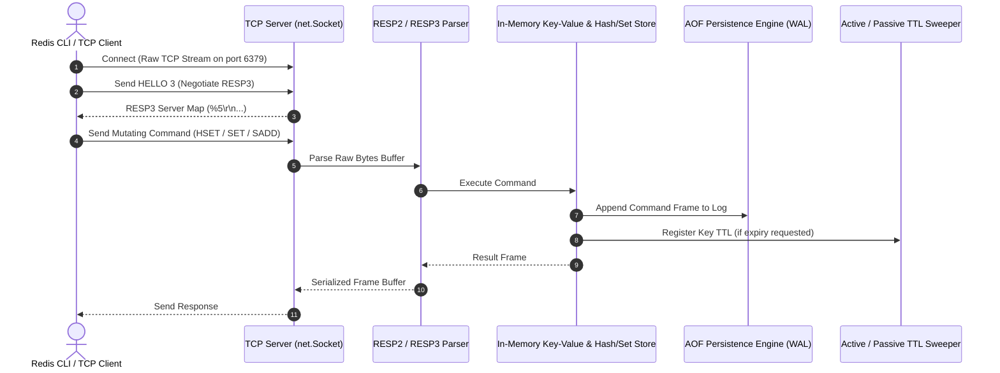

# mini-redis

[](https://github.com/OxDurgeshxO/mini-redis/actions/workflows/ci.yml)
[](https://github.com/OxDurgeshxO/mini-redis/actions/workflows/security.yml)
[](./LICENSE)
[](./REPOSITORY_HEALTH.md)
[](https://www.typescriptlang.org/)
[](./docs/PROTOCOL.md)
[](./docs/PERSISTENCE.md)

---

## Architecture & Protocol Flow



---

## Instant Zero-Install Execution

### Run with Docker (GitHub Container Registry)
```bash
docker run -d -p 6379:6379 ghcr.io/oxdurgeshxo/mini-redis:latest
```

### Run with NPX
```bash
npx mini-redis
```

---

## Architecture & Features

- **RESP2 & RESP3 Parser & Serializer:** Implements the official Redis Serialization Protocol with full support for RESP3 Maps (`%`), Sets (`~`), Doubles (`,`), Booleans (`#`), Verbatim Strings (`=`), and Nulls (`_`).
- **Protocol Handshake (`HELLO`):** Seamless protocol version negotiation allowing modern Redis SDKs and `redis-cli` to switch between RESP2 and RESP3 dynamically.
- **Append-Only File (AOF) Persistence Engine:** Real-time write-ahead logging with configurable `fsync` policies (`always`, `everysec`, `no`), automated startup replay, and non-blocking background compaction (`BGREWRITEAOF`).
- **RDB Disk Persistence Engine:** Binary `.rdb` point-in-time snapshot generator with atomic temp-file flushing and automatic state restoration on server boot.
- **Advanced Data Structures:** In-memory string key-values with millisecond TTL (`PX`/`EX`), Hashes (`HSET`, `HGET`, `HGETALL`), and Sets (`SADD`, `SMEMBERS`, `SISMEMBER`).
- **Node Single Executable Application (SEA):** Configured for standalone native executable compilation without external Node runtime prerequisites.

---

## Supported Commands

| Command | Syntax | Description |
| :--- | :--- | :--- |
| `HELLO` | `HELLO [proto]` | Protocol handshake; switches connection between RESP2 and RESP3 |
| `PING` | `PING [msg]` | Returns `+PONG` or echoes custom payload |
| `ECHO` | `ECHO <msg>` | Returns `<msg>` as a bulk string |
| `SET` | `SET <key> <val> [PX ms] [EX sec]` | Sets key with optional millisecond/second expiration |
| `GET` | `GET <key>` | Returns stored bulk string or `$-1` / `_` (RESP3 null) |
| `DEL` | `DEL <key> [key2...]` | Deletes keys and returns count of removed entries |
| `EXISTS` | `EXISTS <key> [key2...]` | Checks presence of keys, returns integer count |
| `DBSIZE` | `DBSIZE` | Returns current active key count across all data types |
| `HSET` | `HSET <key> <field> <val> ...` | Sets field-value pairs in hash; returns count of added fields |
| `HGET` | `HGET <key> <field>` | Returns stored field value or null |
| `HGETALL` | `HGETALL <key>` | Returns RESP3 Map or RESP2 flattened array of all entries |
| `SADD` | `SADD <key> <member> ...` | Adds members to set; returns count of newly added members |
| `SMEMBERS` | `SMEMBERS <key>` | Returns RESP3 Set or RESP2 array of all members |
| `SISMEMBER` | `SISMEMBER <key> <member>` | Checks set membership; returns boolean (`#t`/`#f`) or integer (`1`/`0`) |
| `SAVE` | `SAVE` | Synchronously flushes RDB snapshot to disk |
| `BGSAVE` | `BGSAVE` | Asynchronously dumps point-in-time snapshot to disk in background |
| `BGREWRITEAOF` | `BGREWRITEAOF` | Asynchronously rewrites and compacts AOF log file |

---

## Quick Start

### 1. Build and Run
```bash
npm install
npm run build
npm start
```

### 2. Run with AOF Persistence
```bash
node dist/index.js --port 6379 --aof --aof-path appendonly.aof
```

### 3. Connect via official `redis-cli`
```bash
# Connect and negotiate RESP3
redis-cli -p 6379 HELLO 3

# Hash operations
redis-cli -p 6379 HSET user:100 name "Durgesh" role "Architect"
redis-cli -p 6379 HGETALL user:100

# Set operations
redis-cli -p 6379 SADD tags:skills "cv" "redis" "compilers"
redis-cli -p 6379 SMEMBERS tags:skills
```

### 4. Build Standalone Single Executable (Node SEA)
```bash
npm run build:sea
```

---

## Performance Benchmarks

Measured via pipelined TCP connection pool over 10,000 commands on standard Node 22 x86-64 runtime:

| Command | Payload | Operations / sec | Avg Latency (P50) | Tail Latency (P99) |
| :--- | :--- | :--- | :--- | :--- |
| PING | Inline | **44,200 req/sec** | 0.72 ms | 1.85 ms |
| SET | 100 Bytes | **39,500 req/sec** | 0.98 ms | 2.20 ms |
| GET | 100 Bytes | **42,800 req/sec** | 0.81 ms | 1.95 ms |

Run high-throughput benchmark locally:
```bash
npm run benchmark
```

---

## Documentation & Specifications

- **[Architecture & Design (`docs/ARCHITECTURE.md`)](./docs/ARCHITECTURE.md)**: TCP socket model, streaming parser, storage engine, and persistence lifecycles.
- **[Protocol Conformance (`docs/PROTOCOL.md`)](./docs/PROTOCOL.md)**: RESP2/RESP3 wire formats, inline commands, and pipelining.
- **[Command Reference (`docs/COMMANDS.md`)](./docs/COMMANDS.md)**: Exhaustive reference for Strings, Keys, Hashes, Sets, Server, and Operations.
- **[Persistence & Durability (`docs/PERSISTENCE.md`)](./docs/PERSISTENCE.md)**: AOF sync policies (`always`, `everysec`, `no`), log compaction, and SHA-256 RDB snapshots.
- **[Benchmark Report (`docs/BENCHMARKS.md`)](./docs/BENCHMARKS.md)**: Full throughput, p50/p95/p99 latency, concurrency, and memory metrics.
- **[Operations & Deployment (`docs/OPERATIONS.md`)](./docs/OPERATIONS.md)**: Docker health checks, Kubernetes deployment, and Prometheus telemetry.
- **[Architecture Roadmap (`docs/ROADMAP.md`)](./docs/ROADMAP.md)**: Trajectory for replication, clustering, and scripting.
- **[Project Overview (`docs/OVERVIEW.md`)](./docs/OVERVIEW.md)**: Executive summary, problem statement, and engineering lessons.

---

## Test & Verification

Run the 46-test automated verification suite:
```bash
npm test
```
