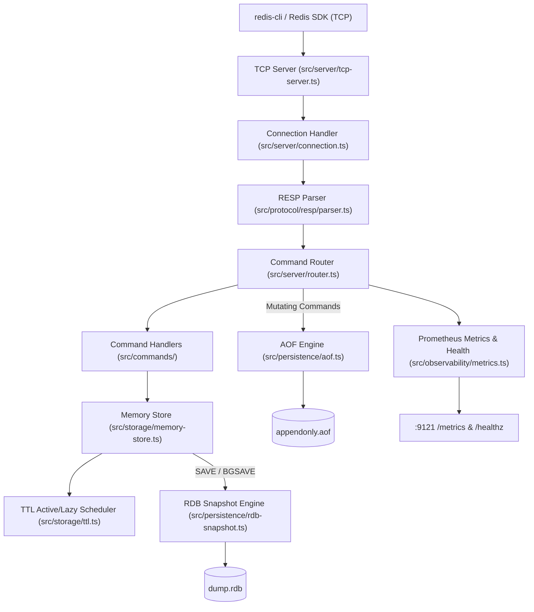

# Architecture & System Design: mini-redis

## 1. System Overview

`mini-redis` is an in-memory, network-accessible data structure store wire-compatible with Redis. It implements the RESP2 and RESP3 wire protocols over raw TCP sockets, providing high-throughput command dispatch, sub-millisecond latencies, deterministic key expiration, memory management with configurable eviction policies, and durable persistence via Append-Only File (AOF) logging and point-in-time RDB snapshots.

---

## 2. Component Design

### 2.1 Server & Networking Layer (`src/server/`)
- **`tcp-server.ts`**: Oversees the TCP socket listener, client tracking, connection ceilings (`maxclients`), backpressure handling, and graceful shutdown orchestration (`SIGINT` / `SIGTERM`).
- **`connection.ts`**: Encapsulates client socket state, per-connection buffer accumulation, protocol version negotiation (`HELLO`), pipelining execution, and socket draining.
- **`router.ts`**: Strongly typed command dispatcher. Intercepts commands, validates argument counts, routes to command domain handlers, benchmarks execution latencies, and funnels write commands to the persistence layer.

### 2.2 Protocol Layer (`src/protocol/resp/`)
- **`parser.ts`**: Zero-copy capable streaming parser for RESP2 and RESP3 specifications. Accumulates partial frames across TCP packet boundaries, handles inline command formats, bulk strings, nulls, integers, simple strings, arrays, and error codes.
- **`encoder.ts`**: Serialization engine formatting in-memory TypeScript structures into exact Redis byte responses (`+OK`, `$-1`, `*2`, `:42`, `-ERR`).

### 2.3 Storage Layer (`src/storage/`)
- **`memory-store.ts`**: In-memory hash tables powering Strings, Hashes, and Sets. Maintains access timestamps (`lastAccessedAt`) for LRU calculation and exact payload byte estimations for memory tracking.
- **`ttl.ts`**: Hybrid expiration scheduler combining:
  1. *Lazy Expiration*: Keys evaluated on access; expired entries immediately evicted.
  2. *Active Expiration*: Periodic background ticks sampling 20 keys with expirations, reclaiming memory for dormant keys.

### 2.4 Persistence Layer (`src/persistence/`)
- **`aof.ts`**: Write-ahead logging engine recording every state-mutating command. Supports configurable sync policies (`always`, `everysec`, `no`).
- **`compaction.ts`**: Background AOF rewriting (`BGREWRITEAOF`) summarizing memory state into minimal creation commands to prevent log unbounded growth.
- **`rdb-snapshot.ts`**: Point-in-time binary snapshotting with `REDIS0009` header, JSON state payload, and cryptographic SHA-256 integrity checksums.
- **`recovery.ts`**: Orchestrates two-phase boot recovery: loads RDB snapshot base, then replays AOF logs.

### 2.5 Observability Layer (`src/observability/`)
- **`logger.ts`**: Structured JSON logging emitting level, timestamp, pid, and correlation context.
- **`metrics.ts`**: Prometheus registry providing standard counter, gauge, and latency histograms over an embedded HTTP service on port 9121.
