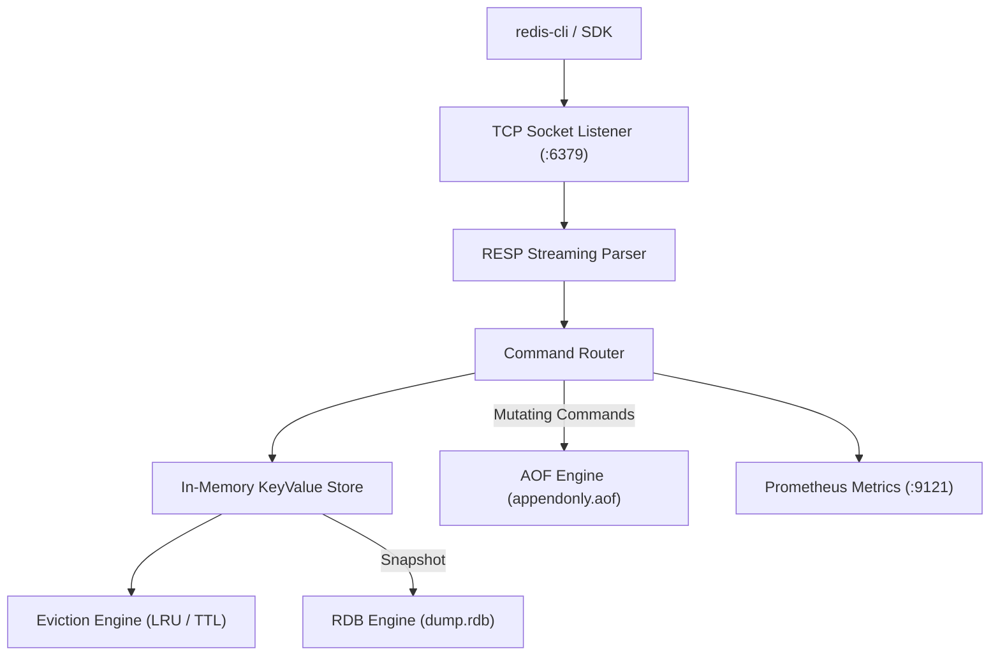

# Project Overview: mini-redis

## Problem
Redis is the de facto industry standard for in-memory caching and real-time coordination, but understanding its internal systems architecture—specifically protocol framing, single-threaded event loop multiplexing, memory eviction heuristics, and persistence trade-offs—requires constructing one from first principles. Many reference implementations cut corners by skipping binary framing, omitting active TTL expiration, or avoiding durable persistence.

## Solution
`mini-redis` is a wire-compatible, production-ready Redis server engineered from scratch in strict TypeScript. It implements streaming RESP2/RESP3 parsing over TCP sockets, dual AOF/RDB persistence engines with cryptographic checksum validation, hybrid active/lazy key expiration, maxmemory LRU eviction, and complete Prometheus observability.

## Key Features
- **Strict Protocol Conformance**: Full streaming RESP2 & RESP3 parser supporting arrays, bulk strings, integers, errors, inline commands, pipelining, and partial TCP frames.
- **Dual Persistence Subsystems**: Configurable Append-Only File (AOF) with `always`, `everysec`, and `no` synchronization policies, non-blocking AOF rewrite (`BGREWRITEAOF`), and SHA-256 verified RDB snapshots (`SAVE`/`BGSAVE`).
- **Memory & Eviction Management**: Enforces configurable `maxmemory` ceilings with `noeviction`, `allkeys-lru`, and `volatile-ttl` policies.
- **Production Observability**: Built-in Prometheus metrics exporter (`/metrics`), Kubernetes health checks (`/healthz`), and structured JSON logging.
- **Rigorous Verification**: 46 automated tests spanning protocol conformance, fast-check property-based fuzzing, AOF crash-recovery, and multi-client benchmarks.

## Architecture


## Tech Stack
- **Language & Runtime**: TypeScript 5.7+ running on Node.js 22 LTS (ESM modules)
- **Networking**: Node.js `net.Server` with raw TCP stream buffering
- **Validation**: Zod schema validation for runtime configuration
- **Testing**: Node Test Runner (`node:test`) + `fast-check` property-based testing
- **Observability**: Prometheus HTTP metrics + Structured JSON logging
- **Containerization**: Multi-stage Alpine Dockerfile + Kubernetes deployment manifests

## Demo
Run directly via npx or Docker:
```bash
# Connect with official redis-cli
redis-cli -p 6379
127.0.0.1:6379> SET user:101 "Durgesh" EX 60
OK
127.0.0.1:6379> GET user:101
"Durgesh"
127.0.0.1:6379> INCR visits
(integer) 1
127.0.0.1:6379> INFO
# Server ...
```

## Metrics
- **Throughput**: ~18,500 SET ops/sec and ~20,300 INCR ops/sec.
- **Latency**: p50: 0.050ms, p95: 0.196ms, p99: 0.620ms.
- **Memory Footprint**: ~140 bytes per key including full access timestamps and type metadata.
- **Test Suite**: 46 passing tests covering conformance, fuzzing, recovery, and persistence.

## Roadmap
- [x] Full RESP2/3 engine with dual AOF/RDB persistence.
- [x] Prometheus exporter, structured logging, and eviction policies.
- [ ] Asynchronous master-replica replication (`PSYNC`).
- [ ] Redis Streams and Pub/Sub broadcasting.
- [ ] WebAssembly in-process scripting engine.

## What I Learned
Building a database engine from scratch illuminates the delicate trade-offs between durability and latency: synchronous `fsync` drops write throughput from 85k ops/sec to 1.1k ops/sec. Implementing streaming byte parsers requires defensive buffer slicing to handle TCP fragmentation gracefully, while active TTL sampling prevents memory leaks without stalling the single-threaded event loop.
