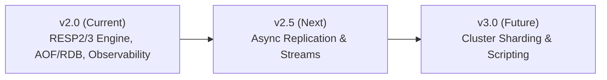

# Architecture Roadmap: mini-redis

This roadmap details the engineering trajectory for `mini-redis` across upcoming milestones.

---

## 1. Milestone Matrix

---

## 2. Milestone Details

### v2.0 (Delivered - Current Release)
- [x] Complete RESP2 parser with inline commands, pipelining, and partial TCP frames.
- [x] Full String, Key, Hash, Set, and Server command sets.
- [x] Dual persistence: AOF write logging (always, everysec, no) + RDB snapshots with SHA-256 validation.
- [x] Active and lazy TTL expiration schedulers.
- [x] Maxmemory enforcement with `noeviction`, `allkeys-lru`, and `volatile-ttl` policies.
- [x] Embedded Prometheus metrics exporter on `:9121/metrics`.
- [x] Property-based fuzz testing suite using `fast-check`.

### v2.5 (Next Milestone - Replication & High Availability)
- [ ] **Asynchronous Master-Replica Replication**: `PSYNC` protocol support with replication backlog buffer.
- [ ] **Read-Only Replicas**: Secondary node clustering allowing horizontal read scaling.
- [ ] **Redis Streams Data Type**: `XADD`, `XREAD`, `XRANGE` for append-only log streaming.
- [ ] **Pub/Sub Subsystem**: Full `SUBSCRIBE`, `UNSUBSCRIBE`, `PUBLISH` event broadcasting over multiplexed sockets.

### v3.0 (Long-Term Exploration - Distributed & Programmable)
- [ ] **Redis Cluster Partitioning**: 16,384 hash slots with CRC16 key hashing and `MOVED` / `ASK` redirects.
- [ ] **WebAssembly / JavaScript Server Scripting**: In-process lightweight scripting engine replacing legacy Lua with isolated V8 contexts.
- [ ] **TLS Encryption**: Native TLS socket support with client mutual authentication (mTLS).
